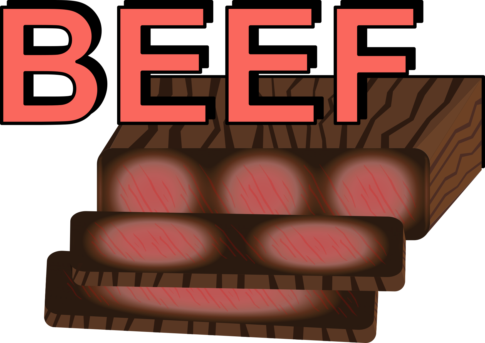

<p align="center">
  
</p>

# BEEF

**B**ridged **E**ngine for **E**ME and **F**DTD — for photonic MMI/coupler devices.

BEEF is a hybrid-methodology orchestration layer on top of [meep](https://meep.readthedocs.io/) (FDTD),
[meow](https://github.com/flaport/meow)/MPB (eigenmode expansion), and optionally
[tidy3d](https://www.flexcompute.com/tidy3d/)'s mode solver — plus a small parametrized photonic-device
geometry library. It is not a competing raw solver; meep/meow/tidy3d do the actual field/mode math.
BEEF's real contribution is `HybridSolver`: a generic N-section FDTD/EME cascade (any solver type, any
order, any count ≥ 2) with reciprocity-based excitation (minimum simulation count) and a shared
`section_prisms/section_gds/width_at/center_at` interface that lets any geometry slot into that cascade.
A fresh pass over the OSS photonics landscape (meep, tidy3d, gdsfactory, SAX/Simphony, FDTDX, and
others) didn't turn up another open-source tool that does this specific thing: a
generic, reciprocity-based FDTD/EME cascade over an arbitrary number of sections.

## Install

Requires Python ≥3.11 (`meow` pulls in `jax` via `sax`, and `jax` no longer ships
for 3.10). Both simulation backends need to come from somewhere other than a
plain PyPI install — do steps 1 and 2 first, then install BEEF.

**1. meow (EME backend) — from git `main`, not the latest release.**

```bash
pip install "meow-sim @ git+https://github.com/flaport/meow.git@main"
```

The newest PyPI release is `meow-sim` 0.15.0 (2026-03-15), months behind `main`.
Install the GitHub tip, not the release.

**2. meep (FDTD backend) — from conda-forge, not pip.**

```bash
conda install -c conda-forge pymeep
# or: micromamba install -c conda-forge pymeep
```

PyPI's `meep` package is an unrelated project (a lightweight task runner).
`pip install meep` installs that silently, with no error — it just leaves
`import meep` broken. The MIT electromagnetics package ships only as
conda-forge `pymeep`. Skip this step if you only need `EMESolver`.

**3. BEEF itself.**

```bash
pip install -e .              # core (numpy, scipy, matplotlib)
pip install -e ".[gds]"       # + gdstk, for GdsGeometry / load_gds_polygons
pip install -e ".[dev]"       # + pytest
pip install -e ".[dev,gds]"   # typical development install
```

Verify:

```bash
python -c "import beef, meow; print(beef.__name__, meow.__version__)"
python -c "import meep; print(meep.__version__)"   # only if you did step 2
```

The `[eme]`, `[fdtd]`, and `[all]` extras declare `meow-sim` and `meep` as plain
PyPI requirements, which is why they are not used above. With steps 1–2 already
done, pip treats `meow-sim` as satisfied and leaves the git checkout in place, so
`".[eme]"` is harmless — but on a clean environment it pulls the stale release,
and `[fdtd]`/`[all]` pull the wrong `meep` entirely.

## Public API

```python
from beef import (
    # geometry
    MMI, MMIPort, BendGeometry, DirectionalCoupler, Taper, SBend,
    CompoundGeometry, WaveguideRun, GdsGeometry, load_gds_polygons,
    arc_polygon, RingResonatorCouplerSection, RingResonatorBendSection,
    # materials
    MaterialStack, SOI_160, SOI_220, SIN_300,
    # solvers
    EMESolver, FDTDSolver, PortSpec, HybridSolver,
    # network
    SMatrixBlock, connect, close_loop, close_loop_pair, Circuit,
    from_transfer_matrix, from_smatrix, to_smatrix,
    # mode identity
    field_overlap_matrix, best_correspondence, mesh_cell_centers, stack_meow_mode_fields,
    overlap_diagnostics, self_overlap_diagnostics,
    # device-agnostic checks
    cut_position_invariance, interface_modes_convergence,
    # spectral resampling
    interp_complex, unwrap_is_safe,
    # results
    SMatrix,
    # sweep
    ParallelSweep,
    # plot
    plot_eme_fields, plot_eme_geometry, plot_fdtd_geometry, plot_hybrid_geometry,
    plot_section_fdtd_geometry, plot_performance, plot_splitting_ratio,
    plot_beta_calibration, plot_beta_calibration_fits,
    plot_beta_calibration_geometry, plot_beta_calibration_merged_geometry,
    plot_beta_calibration_summary,
    # utilities
    extrude_polygons, atomic_replace_write,
)
```

> This block mirrors `beef/__init__.py`'s `__all__`; if you add a public name
> there, add it here too. (`UniformCrossSection` is exported from
> `beef.geometry` only, not from the top level.)

- **Geometry** (`beef/geometry/`) — `MMI` (N×M splitter/combiner, per-port `MMIPort` taper specs,
  `input_idx`/`output_idx` to isolate a single port on multi-port devices like a 2×2),
  `DirectionalCoupler` (2-waveguide coupler w/ S-bend I/O), standalone `Taper`/`SBend` building blocks,
  `CompoundGeometry`/`WaveguideRun` (concatenate several geometries into one cascade), legacy `BendGeometry`
  (90° bend for non-collinear FDTD I/O), `arc_polygon` (quarter-annulus wedge, for constant-radius bends),
  `RingResonatorCouplerSection`/`RingResonatorBendSection` (ring resonator geometry primitives — not yet
  wired into `HybridSolver` or an example).
- **Materials** (`beef/materials/`) — `MaterialStack` (Si/SiO2 layer stack), plus pre-built `SOI_160` /
  `SOI_220` stacks. One analytic Sellmeier model (Salzberg Si, Malitson SiO2) backs both
  engines, so an EME mode solve and an FDTD run agree on n(λ) to machine precision. The
  FDTD still freezes one index per broadband run.
- **Solvers** (`beef/solvers/`) — `EMESolver` (meow-based EME), `FDTDSolver` (meep-based FDTD, 2D or 3D),
  `HybridSolver` (chains FDTD and EME sections together — the core BEEF method; optionally skips
  re-solving a section declared as the x-mirror of an already-solved one via `mirror_pairs`, and can
  sweep one uniform section's length analytically via `solve_length_sweep()` at no extra simulation cost).
  Every solve-family method (`FDTDSolver.solve()`/`solve_section()`, `EMESolver.solve()`/
  `solve_section()`/`solve_section_length_sweep()`, `HybridSolver.solve()`/`solve_length_sweep()`)
  accepts an optional `save_dir` — see Simulation cache below. `FDTDSolver.solve_section()` also
  accepts `y0`/`y1` and `excite_port`/`measure_port` (`PortSpec`) to place a source/monitor on a
  y-normal (not just x-normal) plane — additive, every existing call is unaffected — for sections
  with a non-x-normal port (e.g. a ring resonator's coupling port). `FDTDSolver.section_mode_fields()`
  is the field-profile counterpart of `section_mode_neff()` — same cheap `get_eigenmode()`-only
  solve, but returns sampled `Ex..Hz` per mode instead of just n_eff, for `beef.mode_identity`
  below; `EMESolver.section_modes()` is its EME-side counterpart, surfacing the raw `meow.Mode`
  list `solve_section()` already computes internally but never returns. `HybridSolver(
  check_mode_correspondence=True)` wires `beef.mode_identity` into `solve()`/`solve_length_sweep()`
  itself — an opt-in runtime check that each interior interface's adjoining bases actually
  correspond, rather than trusting the index-*i*-to-index-*i* contraction blindly. Both sides'
  modes are compared on one shared mesh whose resolution defaults to the coarser of the two
  adjoining solvers' own `res` (override with `mode_correspondence_res`; raise it if a reported
  mismatch looks like under-resolution rather than a real disagreement).
- **Results** (`beef/results/`) — `SMatrix`, a unified S-parameter result type with transmission/insertion-loss
  helpers and a `check_passive()` sanity check.
- **Network** (`beef/network/`) — general S-matrix composition via Redheffer star products: `connect()` joins
  two blocks' ports, `close_loop()` eliminates a block's own port against itself (node elimination — verified
  against the ring resonator's proven closed-form all-pass formula), `Circuit` builds a multi-block network.
  Depends only on `SMatrix`/`numpy`; not yet wired into `HybridSolver` or any example.
- **Mode identity** (`beef/mode_identity.py`) — device- and resolution-agnostic check for whether
  `HybridSolver`'s index-*i*-to-index-*i* contraction between an FDTD interface basis and an EME
  body basis is actually valid. `field_overlap_matrix()` computes the normalized transverse
  E-field overlap between every pair of modes from the two engines (matching field *shape*, not
  the scalar n_eff, so it does not fool the way nearest-neighbor n_eff matching does when several
  modes crowd close together — found directly on the modal multiplexer's 16-mode basis);
  `best_correspondence()` then picks
  the overlap-maximizing one-to-one assignment (Hungarian algorithm), not nearest-neighbor.
  Deliberately E-only, not the full E-x-H reciprocity overlap: meep and meow were found to report
  E and H in mutually inconsistent absolute units (~375x apart on a real solved mode, each engine
  internally self-consistent) — comparing E against E only sidesteps that entirely.
  `mesh_cell_centers()`/`stack_meow_mode_fields()` bridge an `EMESolver` mesh/modes to the grid and
  array shape `FDTDSolver.section_mode_fields()` expects (remapping meow's own local field-axis
  convention into beef's device frame along the way), so the two engines' output is directly
  comparable regardless of device symmetry or which resolution each side used.
- **Sweep** (`beef/sweep/`) — `ParallelSweep`, a local `multiprocessing`-based parameter grid sweep.
- **Plot** (`beef/plot/`) — geometry, field, and performance (transmission/insertion-loss/splitting-ratio) plots.

## Quick start

```python
import numpy as np
from beef import MMI, EMESolver, SOI_160, plot_performance

mmi = MMI(
    n_inputs=1, n_outputs=2,
    mm_length=4.5, mm_width=2.0,
    waveguide_width=0.35, taper_length=1.0, taper_width=0.8,
    waveguide_offset=1.0, waveguide_height=0.16,
)

solver = EMESolver(
    num_modes=[1, 5, 12, 5, 1],
    num_cells=[1, 8, 1, 8, 1],
    lengths=[0.5, 1.0, 4.5, 1.0, 0.5],
    oxide_width=5.0, oxide_height=1.5, res=40.0,
    material_stack=SOI_160, mode_solver="tidy3d",
)

wavelengths = np.linspace(1.26, 1.36, 11)
smat = solver.solve(mmi, wavelengths, ports=["out_top"], output_idx=1)
smat.check_passive()
plot_performance(smat, output_dir="out", title="1x2 MMI Splitter (EME)")
```

## Simulation cache

Every solve-family method accepts an optional `save_dir: str` (default `None`,
i.e. disabled — no behavior change if you don't pass it). When set, a call is
fingerprinted from the solver's own parameters, the call's arguments, the exact
geometry it draws, and the refractive indices it resolved; a matching prior run
is loaded from disk instead of re-simulated, and a new run is written there for
next time:

```python
smat = solver.solve(mmi, wavelengths, port="top", input_mode=1, save_dir="sim_cache")
```

Each cache entry gets its own subfolder (named by a hash of the fingerprint)
holding `config.json` (human-readable), `result.pkl`, and a `geometry.png`
preview. `examples/` wires every applicable example up to a shared
`example_sim_cache/` directory this way — a sibling of `BEEF/` and
`example_output/`, i.e. outside the repo, so multi-GB simulation results are
never committed — re-running an example, or
another example that happens to solve an identical section, reuses cached
results automatically; every example's `.py` script and its paired `.ipynb`
notebook fingerprint identically too, so running either one hits a cache
entry the other left behind. One known gap: `EMESolver.solve_sweep()` does
not support the cache yet.

## Examples

See `examples/` — one folder per device, each with a `python/` subfolder (`.py` scripts) and,
where a notebook version exists, a `notebooks/` subfolder (matching `.ipynb`):

- `examples/mmi_1x2/` — 1×2 MMI splitter (EME, FDTD, hybrid)
- `examples/mmi_2x2/` — 2×2 MMI splitter (EME, FDTD, hybrid) — a genuine multi-input device,
  exercising `MMI`'s `input_idx`/`input_indices` support
- `examples/directional_coupler/` — directional coupler (FDTD, FDTD length sweep, hybrid, even/odd
  supermode coupling-length analysis)
- `examples/modal_multiplexer/` — modal multiplexer (hybrid)
- `examples/ring_resonator/` — racetrack ring resonator (hybrid: raw-meep coupler-section +
  90° bend FDTD, mode-solve neff interpolation, closed-form all-pass feedback assembly —
  no `DeviceGeometry`/`FDTDSolver` support yet for this device)

Run any example directly:

```bash
python examples/mmi_1x2/python/mmi_1x2_eme.py
```

Output (geometry/field/performance plots, `smatrix.pkl`) goes to `example_output/<device>/<example>/`.

`examples/Makefile` runs examples via `mpirun`/`srun` (auto-detects SLURM/Phoenix), with per-device
and `all` aggregate targets:

```bash
cd examples
make mmi_1x2              # all mmi_1x2 variants
make directional_coupler_fdtd_sweep SWEEP_INDEX=3
make clean
```

## Testing

Fast unit tests (`tests/test_geometry.py`, `test_smatrix.py`, `test_hybrid.py` — no meep/meow
required) run in CI on every push/PR (`.github/workflows/ci.yml`):

```bash
pytest tests/
```

`tests/test_golden_examples.py` additionally runs a real (reduced-resolution) meep/meow
simulation per target — mmi_1x2 (EME, FDTD, hybrid) and directional_coupler (hybrid) — and checks
transmission against a recorded reference in `tests/golden/`. These are genuinely slow (each
target is a real simulation, not a mock, at `res=20` vs the real examples' `res=40`) and are
skipped unless explicitly requested:

```bash
pytest tests/ --runslow
```

Real per-target wall-clock times on a single CPU core (macOS laptop, no MPI parallelism):
mmi_1x2_eme ~7 min, mmi_1x2_fdtd ~12 min, mmi_1x2_hybrid ~58 min, directional_coupler_hybrid
~96 min — even at reduced resolution, a real FDTD/EME solve is real solve time, not a mock; the
hybrid targets are the slowest since HybridSolver's short interior `solve_section()` spans need
`dpml` raised (0.5→1.0 µm) to keep enough PML pixels at `res=20`, which grows the domain.

Budget roughly 3 hours to run the full `--runslow` suite locally. Not covered yet: `mmi_2x2_*`
and `modal_multiplexer_hybrid` have no golden test (`modal_multiplexer_hybrid` deliberately — its
numerical accuracy isn't yet trusted enough to lock in as a reference).

To regenerate the recorded references after a deliberate change to solver behavior:

```bash
python scripts/generate_golden_values.py                # all targets
python scripts/generate_golden_values.py mmi_1x2_eme     # one target
```

If you're on macOS behind a VPN, `meep`'s MPI backend can crash on interpreter exit with an
OFI/libfabric error (`OFI poll failed`) — `tests/conftest.py` sets `FI_PROVIDER=tcp` by default to
avoid this; results are unaffected either way, it's purely a finalize-time crash.

### Slow suite in CI

`.github/workflows/slow-tests.yml` runs the 4 golden targets as a 4-way parallel matrix (one job
per target, ~96 min wall-clock for the slowest instead of ~3hr serial) — manual trigger only
(`workflow_dispatch`), not on every push: the repo is public so Actions minutes are free, but
there's no value in paying the wall-clock cost on every PR for tests this coarse. Trigger it from
the repo's Actions tab, or:

```bash
gh workflow run slow-tests.yml
```

**Packaging note**: this workflow installs `pymeep` from conda-forge
(`mamba-org/setup-micromamba`), not via `pip install beef[fdtd]`/`beef[all]`, for the reason given
under Install — PyPI's `meep` is an unrelated project and those extras are misleading as declared
in `pyproject.toml`. Worth fixing separately.

